<!-- ════════════════════════════════════════════════════════════════════ -->
<!--              🎌 TAI TETSUYUKI — DASHBOARD README                    -->
<!-- ════════════════════════════════════════════════════════════════════ -->

<!-- 🌊 HEADER ANIMÉ -->

  

<!-- ✨ TYPING ANIMATION -->

  

<!-- 🏷️ BADGES DE STATUT -->

  
  
  

 

<!-- 🧭 NAVIGATION -->

---

<!-- ════════════════ 🧩 WIDGETS — VUE D'ENSEMBLE ════════════════ -->

## 🧩 Vue d'ensemble

<table align="center">
<tr>
<td width="50%" valign="top">

### 👤 Profil

| | |
|:---|:---|
| **Nom** | Tai Tetsuyuki |
| **Rôle** | Full Stack Dev & UI/UX Designer |
| **Studio** | Tai Studio |
| **Focus** | Web · Design Systems · Open Source |
| **Statut** | 🟢 Disponible |
| **Fuseau** | `Europe/Paris (UTC+1)` |
| **Langues** | 🇫🇷 · 🇬🇧 · 🇯🇵 |

</td>
<td width="50%" valign="top">

### 📊 Stats rapides

  
   
  
  

**🕐 Fuseau horaire :** `Europe/Paris (UTC+1)`  
**💬 Langues :** 🇫🇷 · 🇬🇧 · 🇯🇵

</td>
</tr>
</table>

---

<!-- ════════════════ 🌌 À PROPOS ════════════════ -->

## 🌌 À propos

> **Développeur Full Stack** & **Designer UI/UX**, passionné par la création d'expériences numériques élégantes, performantes et accessibles. Mon approche combine la rigueur technique du code et la sensibilité esthétique du design pour transformer des idées complexes en outils intuitifs.

<table align="center">
<tr>
<td align="center" width="25%">🛠️ <b>Architecture</b> Robuste & scalable</td>
<td align="center" width="25%">🎨 <b>Design</b> Moderne & fluide</td>
<td align="center" width="25%">🌍 <b>Open Source</b> Contribution active</td>
<td align="center" width="25%">🚀 <b>Collaboration</b> Freelance & projets</td>
</tr>
</table>

---

<!-- ════════════════ ⚡ STACK ════════════════ -->

## ⚡ Stack & Outils

  

<table align="center">
<tr>
<td align="center" valign="top" width="33%">

### 🎨 Frontend

</td>
<td align="center" valign="top" width="33%">

### ⚙️ Backend & DB

</td>
<td align="center" valign="top" width="33%">

### 🚀 DevOps & Outils

</td>
</tr>
</table>

  
  
  
  

---

<!-- ════════════════ 🚀 PROJETS ════════════════ -->

## 🚀 Projets Phares

<table align="center">
<tr>
<td align="center">🎬 <b>AnimeBack</b> Wallpapers animés Windows</td>
<td align="center">🔗 <b>Lyna</b> Page de liens tout-en-un</td>
<td align="center">🔔 <b>GitHub 2 Discord</b> Notifications de releases</td>
<td align="center">⛏️ <b>NeoTerra</b> Modpack Minecraft</td>
<td align="center">🖤 <b>Trenton</b> Portfolio minimaliste</td>
</tr>
</table>

---

<!-- ════════════════ 📊 DASHBOARD ════════════════ -->

## 📊 Tableau de bord

<!-- WIDGETS CÔTE À CÔTE -->

<!-- STREAK -->

<!-- ACTIVITY GRAPH -->

<!-- TROPHÉES -->

<!-- CONTRIBUTION SNAKE (animation) -->
<picture>
  <source media="(prefers-color-scheme: dark)" srcset="https://raw.githubusercontent.com/LeGitHubDeTai/LeGitHubDeTai/output/github-contribution-grid-snake-dark.svg" />
  <source media="(prefers-color-scheme: light)" srcset="https://raw.githubusercontent.com/LeGitHubDeTai/LeGitHubDeTai/output/github-contribution-grid-snake.svg" />
  
</picture>

---

<!-- ════════════════ 💼 CONTACT ════════════════ -->

## 💼 Me contacter

---

<!-- ════════════════ 🧡 SOUTIEN ════════════════ -->

### 🧡 Soutenez mon travail

Ton soutien me permet de continuer à développer et à partager librement.

<!-- 🌊 FOOTER ANIMÉ -->
